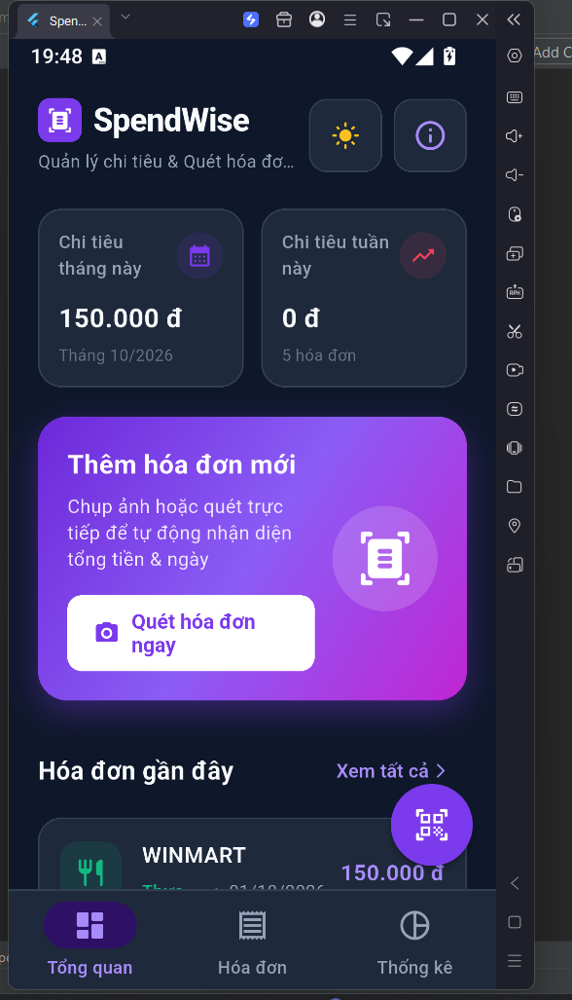
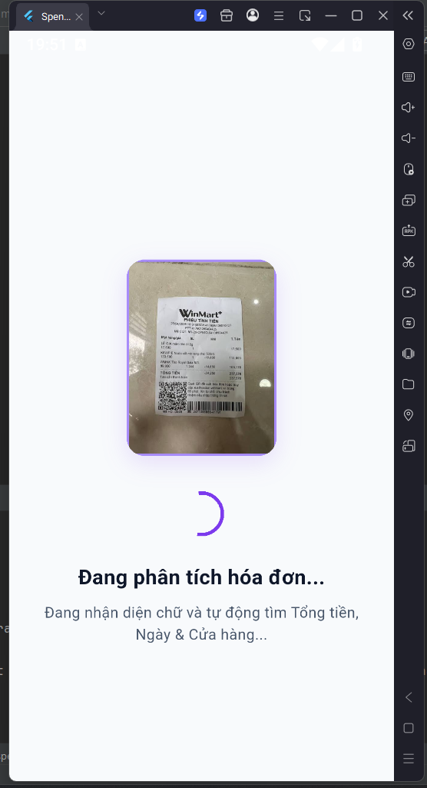
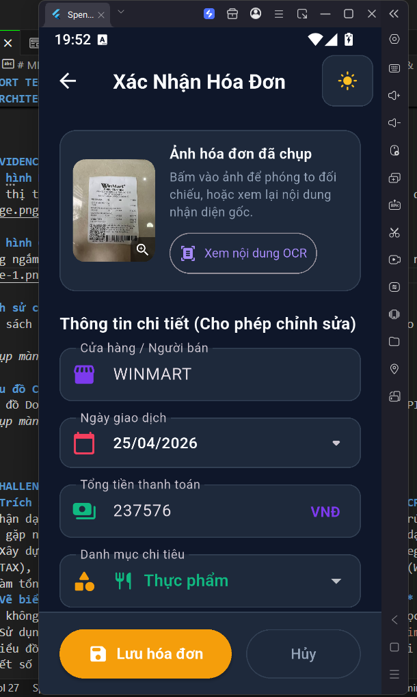
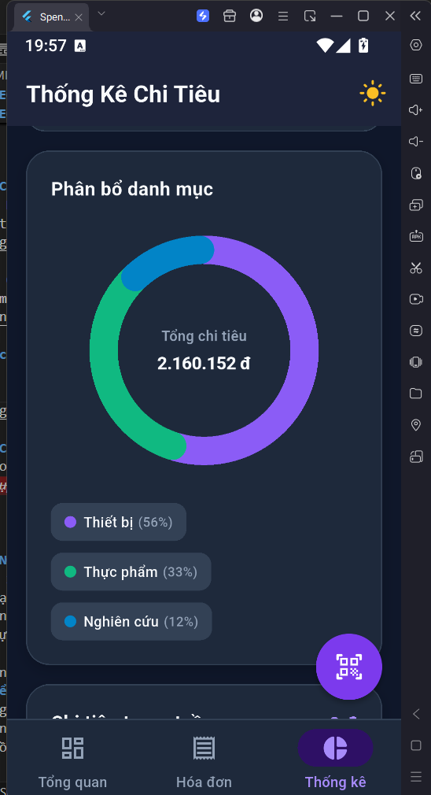

# MINI-PROJECT SHORT TECHNICAL REPORT
**Course:** Cross-Platform Mobile App Development (VKU)
**Mini-Project Title:** Mini-Project 3 - SpendWise (Smart Receipt & Expense Tracker)
**Team / Student Name:** Nguyễn Như Huy
**Submission Date:** 09/10/2026

---

## 1. GENERAL INFORMATION & DELIVERABLE LINKS
* **Team Members:** Nguyễn Như Huy — Student ID: 23IT.B077
* **🔗 Live Demo URL:** https://github.com/nhuhuy05/mini-project3/releases/download/v1.0.0/app-release.apk
* **💻 GitHub Repository:** https://github.com/nhuhuy05/mini-project3
---

## 2. FEATURE IMPLEMENTATION CHECKLIST
| # | Required Feature | Status | Implementation Details & Acceptance Level |
|:---:|---|:---:|---|
| 1 | On-Device Text Recognition (OCR) | ✅ Complete | Tích hợp Google ML Kit trích xuất văn bản ngoại tuyến từ camera và thư viện ảnh, không cần Internet. |
| 2 | Heuristic Regex Data Extraction | ✅ Complete | Xây dựng bộ parser bóc tách tự động Tên cửa hàng, Ngày giao dịch, Tổng tiền và lọc dòng tiêu đề blacklist. |
| 3 | Local Database Persistence | ✅ Complete | Sử dụng SQLite (`sqflite`) lưu trữ 100% dữ liệu cục bộ trên thiết bị, hỗ trợ đầy đủ thao tác CRUD và lưu ảnh an toàn. |
| 4 | Native Data Visualization | ✅ Complete | Xây dựng biểu đồ vành khăn (Donut) và biểu đồ cột (Bar) vẽ thuần Canvas API bằng `CustomPainter` (không dùng thư viện ngoài). |
| 5 | Clean UI/UX & State Management | ✅ Complete | Thiết kế chuẩn Material 3 (Tím Hoàng Gia & Hồng Neon), hỗ trợ chuyển đổi Light/Dark mode toàn diện và quản lý trạng thái bằng `ChangeNotifier`. |

---

## 3. TECHNICAL ARCHITECTURE & PROJECT STRUCTURE
* **Architecture Pattern:** Clean / Layered Architecture. Dự án phân tách rõ ràng trách nhiệm giữa các tầng:
  - **Core / Services:** Chứa logic nghiệp vụ cốt lõi gồm `ocr_service`, `receipt_parser_service`, lưu trữ ảnh `receipt_image_storage_service` và bộ điều khiển trạng thái `receipt_controller.dart`.
  - **Data Layer:** Cấu hình cơ sở dữ liệu SQLite (`app_database.dart`), DTO models và `receipt_repository.dart` xử lý truy vấn CRUD.
  - **Features (UI):** Phân chia module tính năng độc lập (`home`, `scan`, `receipt`, `expenses`, `statistics`) chứa màn hình và widgets tương ứng.
* **State Management:** Áp dụng mô hình `ChangeNotifier` / `ListenableBuilder` tích hợp sẵn của Flutter, giúp cập nhật trạng thái phản ứng nhẹ nhàng và hiệu quả trên toàn ứng dụng.
* **Exception Handling:** Sử dụng khối `try-catch` chặt chẽ quanh các tác vụ bất đồng bộ (truy vấn SQLite, khởi tạo camera, nhận dạng ML Kit). Thông báo lỗi thân thiện qua `SnackBar` thay vì gây crash ứng dụng.

---

## 4. EMPIRICAL EVIDENCE & SCREENSHOTS

* **Figure 1: Màn hình Dashboard & Thống kê nhanh (Home Screen)**
  * *Mô tả:* Hiển thị thẻ số liệu chi tiêu tháng/tuần từ SQLite, banner gradient quét hóa đơn và danh sách hóa đơn gần đây (chế độ Dark Mode).
  
  

* **Figure 2: Màn hình Phân tích On-Device OCR (Scanning Screen)**
  * *Mô tả:* Tiến trình trích xuất ký tự quang học offline bằng Google ML Kit, tự động bóc tách thông tin từ ảnh chụp hóa đơn WinMart.
  
  

* **Figure 3: Màn hình Xác nhận & Chỉnh sửa (Receipt Review Screen)**
  * *Mô tả:* Màn hình đối chiếu ảnh gốc, kiểm tra kết quả bóc tách (Cửa hàng: WINMART, Ngày: 25/04/2026, Tổng tiền: 237.576 VNĐ, Danh mục: Thực phẩm) trước khi lưu.
  
  

* **Figure 4: Biểu đồ CustomPainter & Giao diện Tối (Statistics Screen)**
  * *Mô tả:* Biểu đồ vành khăn (CategoryDonutChart) vẽ thuần bằng Canvas API trực quan hóa tỷ trọng chi tiêu các danh mục trong chế độ Dark Mode.
  
  

---

## 5. TECHNICAL CHALLENGES & RESOLUTIONS
* **Challenge 1: Trích xuất dữ liệu có nghĩa từ văn bản OCR thô (Unstructured OCR Text)**
  * *Mô tả:* Bộ nhận dạng OCR trả về các khối văn bản rời rạc, không theo cấu trúc bảng. Việc xác định đâu là tên cửa hàng, ngày giao dịch và số tiền thanh toán gặp nhiều khó khăn do hóa đơn tại Việt Nam có rất nhiều định dạng khác nhau.
  * *Giải pháp:* Xây dựng `ReceiptParserService` áp dụng thuật toán Heuristic Regex. Thiết lập danh sách Blacklist để lọc các dòng tiêu đề rác (HÓA ĐƠN, VAT, TAX), ưu tiên so khớp các chuỗi siêu thị/thương hiệu phổ biến (WinMart, Circle K,...), và tìm kiếm giá trị tiền tệ lớn nhất trong văn bản làm tổng tiền.
* **Challenge 2: Vẽ biểu đồ dữ liệu tương tác mà không dùng thư viện bên thứ 3**
  * *Mô tả:* Việc không sử dụng thư viện ngoài đòi hỏi phải tự tính toán hình học, tọa độ góc quay và xử lý hoạt ảnh từ đầu.
  * *Giải pháp:* Sử dụng thành thạo `CustomPainter` và `Canvas` API kết hợp `AnimationController`. Tính toán góc quét `sweepAngle` theo tỷ trọng phần trăm cho biểu đồ Donut và tính toán chiều cao cột theo tỷ lệ chi tiêu tối đa cho biểu đồ cột tuần, đồng thời tích hợp cảm ứng chạm điểm để hiển thị chi tiết số liệu.
